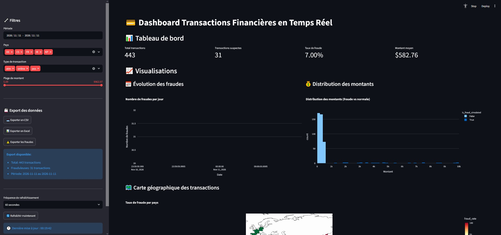
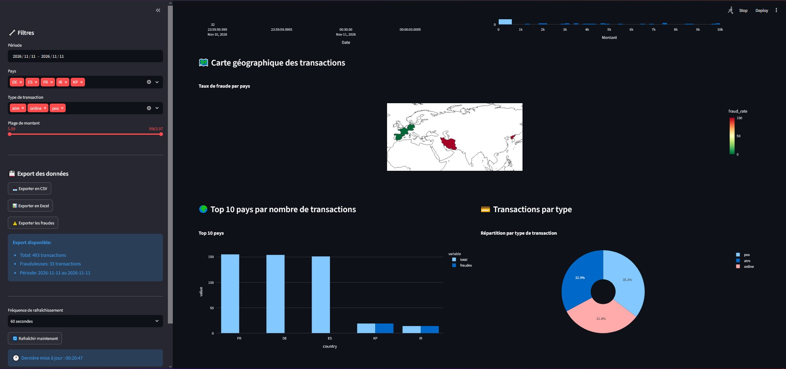
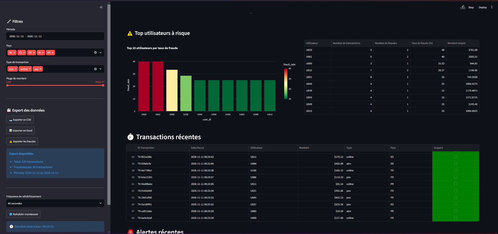
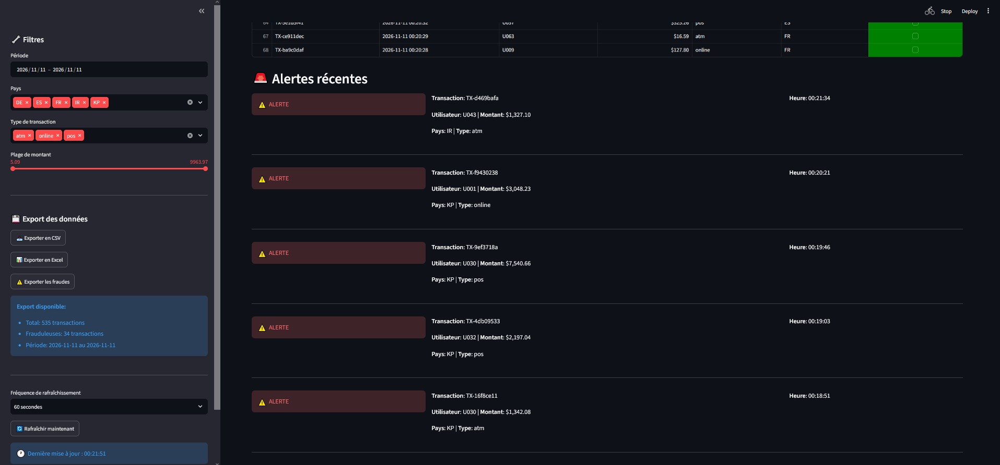
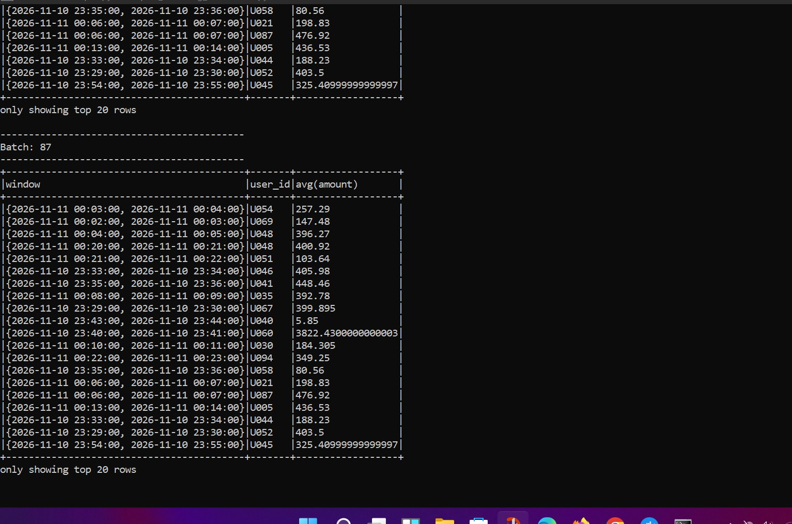
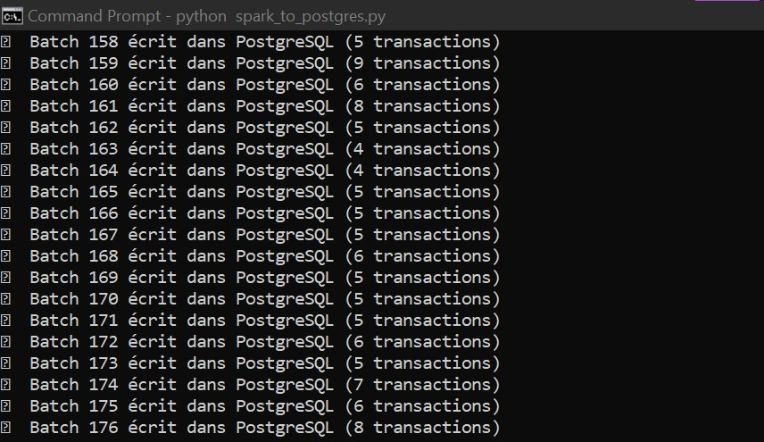

# Real-Time Financial Fraud Detection

Pipeline de détection de fraude en temps réel sur des transactions SIMULÉES.

## Architecture
Générateur de transactions -> Kafka -> Spark Structured Streaming -> PostgreSQL -> Dashboard Streamlit

## Prérequis
- Docker Desktop (Kafka et Zookeeper)
- Python 3 et Java 11
- PostgreSQL 16 (base financial_dw)
- PySpark 3.3.2
- Pilote JDBC postgresql-42.7.8.jar (à télécharger sur https://jdbc.postgresql.org/download/)
- Windows : winutils.exe et hadoop.dll dans C:\hadoop\bin

## Installation
1. python -m venv .venv
2. .venv\Scripts\activate
3. pip install -r requirements.txt
4. Copier .env.example en .env et renseigner DB_PASSWORD

## Lancement
1. docker compose up -d
2. python kafka_transaction_producer.py
3. python spark_to_postgres.py
4. streamlit run dashboard_streamlit.py

## Captures d'écran

## Avertissement
Les transactions et les fraudes sont simulées. Ce projet est un prototype.
Les métriques de la section « Performances du modèle » du dashboard sont des
valeurs d'exemple fixes, non issues d'un entraînement. Le script
train_fraud_model.py n'a pas été exécuté dans cette version.